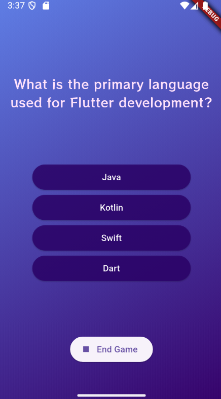
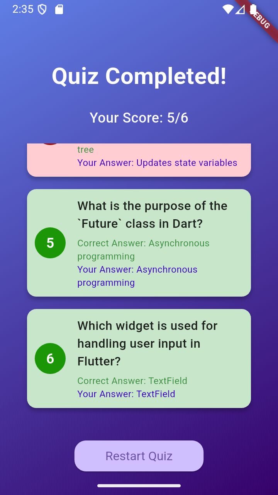

# 🧠 S-Quiz — Flutter Quiz Game

[](https://github.com/NourMontacer01/Flutter-Simple-Quiz-App/actions/workflows/flutter.yml)


A small multi-screen quiz game that tests your knowledge of **Flutter and Dart**.
Answer each question, then get a colour-coded summary showing what you got right and what the correct answer was.

<p align="center">
  
  
  
</p>

## ✨ Features

- **Start → Questions → Results** flow driven by a single stateful widget
- Answers are **shuffled** for every question, so the right one is never in the same place
- **Score** at the end (`Your Score: 4/5`) and a scrollable **summary** of each question:
  green when you were right, red when you were wrong, with the correct answer shown
- **End Game** during the quiz and **Restart Game** from the results screen
- Custom typography with **Google Fonts**

## 🧱 How it works

| File | Role |
| --- | --- |
| `lib/quiz.dart` | Holds the app state: active screen and chosen answers |
| `lib/start_screen.dart` | Landing screen with the Start button |
| `lib/questions_screen.dart` | Shows one question at a time with shuffled answers |
| `lib/results_screen.dart` | Computes the score and shows the summary |
| `lib/questions_summary.dart` | Per-question result cards |
| `lib/data/questions.dart` | The questions. **The first answer of each list is the correct one** |
| `lib/models/quiz_question.dart` | `QuizQuestion` model and answer shuffling |

### Add your own questions

Append a `QuizQuestion` to `lib/data/questions.dart`, putting the correct answer **first**:

```dart
QuizQuestion(
  'Which widget rebuilds when its state changes?',
  ['StatefulWidget', 'StatelessWidget', 'InheritedWidget', 'Container'],
),
```

## 🚀 Getting started

Requirements: [Flutter](https://docs.flutter.dev/get-started/install) 3.27+ (Dart 3.6+).

```bash
git clone https://github.com/NourMontacer01/Flutter-Simple-Quiz-App.git
cd Flutter-Simple-Quiz-App
flutter pub get
flutter run
```

## 🧪 Tests

```bash
flutter test
```

The suite covers answer shuffling, starting the quiz, a perfect run, a wrong run, **Restart Game** and **End Game**.
It runs on every push through GitHub Actions together with `flutter analyze`.

## 📄 License

[MIT](LICENSE) © Nour Montacer
